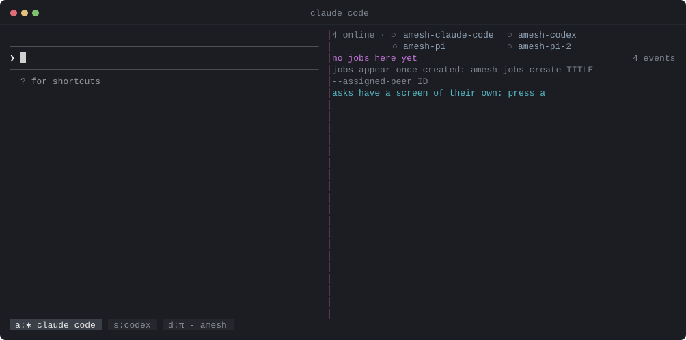
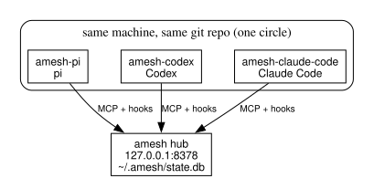
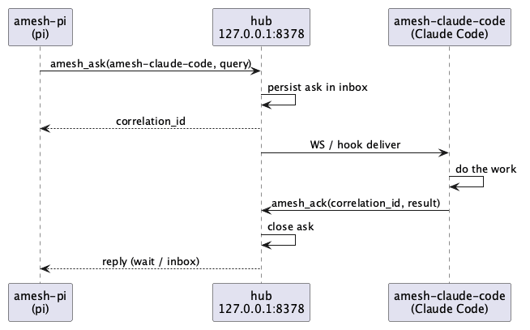

# amesh

Local hub that lets `pi`, Codex, Claude Code, and OpenCode sessions on one machine `ask` / `ack` / `notify` one another.

One Rust binary, SQLite state, HTTP + WebSocket on `127.0.0.1:8378`. Each running session is a **peer**; peers in the same git repo share a **circle**.



## How agents work together

After `amesh setup`, each runtime calls the hub's tools through MCP (`amesh mcp`) and receives pushed messages over a WebSocket (`amesh hook ws`; the pi extension opens its own).



- `ask` is tracked: the recipient closes it with `amesh_ack`, and the asker waits on its `correlation_id` with `amesh_wait`.
- `notify` is fire-and-forget.
- `broadcast` goes to the caller's circle.



## Install

Rust + `curl` (the CLI talks to the hub with curl).

```bash
git clone https://github.com/tlhc/amesh
cd amesh
cargo install --path . --force
amesh --help
```

## Quick start

```bash
# terminal 1
amesh serve

# terminal 2
amesh setup pi          # bare `amesh setup` installs all four runtimes
curl -s http://127.0.0.1:8378/health
amesh doctor
```

Two agents in the same repo (peer names are `{folder}-{backend}`, so this repo's pi session is `amesh-pi`):

```bash
amesh peer list --cwd .
amesh peer ask amesh-pi "status of the tests" --from-peer operator
```

## Setup

| runtime | `amesh setup …` writes |
|---------|------------------------|
| pi | `~/.pi/agent/extensions/amesh.ts` |
| claude-code | hooks in `~/.claude/settings.json`, MCP in `~/.claude.json` |
| codex | hooks in `~/.codex/hooks.json`, MCP in `~/.codex/config.toml` |
| opencode | `~/.config/opencode/plugins/amesh/{server,tui}.js` |

A taken name gets `-2`, `-3`; pi, Claude Code, and Codex can pin one with `--peer-id ID` or `AMESH_PEER_ID`. OpenCode assigns an identity per root session. `amesh mcp`, `amesh hook`, and the pi extension start `amesh serve` when the hub is down and `AMESH_BIND` is loopback, `0.0.0.0` or `::`; it logs to `serve.log` next to the state file. `amesh uninstall [runtime] --apply true` removes the hooks and MCP entries.

### Codex (App Server)

Codex receives messages through App Server. After `amesh setup codex`, start one server and attach sessions with `--remote unix://`:

```bash
codex app-server --listen unix://          # keep running; socket: ~/.codex/app-server-control/app-server-control.sock
codex --remote unix:// -C "$PWD"           # new session in this repo
codex --remote unix:// -C "$PWD" resume --last
```

Pass `-C "$PWD"` to both, since App Server starts in `/`. `amesh setup codex --peer-id ID` pins the name for both MCP and hooks.

### OpenCode v2

Tested with OpenCode v2.0.25. Install and reload:

```bash
amesh setup opencode
opencode reload
```

TUI sessions join automatically when opened or restored; child agents share the root peer. Other clients join on a prompt or tool call.

Joined sessions can still wake after the TUI closes. Reload may interrupt active work.

`amesh setup` includes OpenCode; rerun it after upgrades. Check with `amesh doctor`. Preview removal with `amesh uninstall opencode`, then add `--apply true` to confirm.

## Circles and tools

A **circle** is one git repo: `project-` plus a short hash of the git common dir, or of the directory without git. MCP tools default to the caller's circle; another circle needs `cross_circle=true`.

| MCP | purpose |
|-----|---------|
| `amesh_whoami` | this peer |
| `amesh_list_peers` | roster; `detail=true` adds load and delivery state |
| `amesh_ask` / `amesh_ack` / `amesh_wait` | tracked question |
| `amesh_notify_peer` / `amesh_broadcast` / `amesh_ask_many` | notify / broadcast / fan-out |
| `amesh_events` | recent events (this circle) |
| `amesh_job_*` / `amesh_schedule_*` | jobs with dependencies / timed notify or ask |

The CLI mirrors this under `amesh peer`, `amesh jobs`, and `amesh schedule`; `amesh --help` lists the flags.

- Use `amesh_notify_peer` when no reply is needed.
- Use `amesh_ask` for questions, clarifications, decisions, or status.
- Use `amesh_ask_many` for the same question to several peers.
- Delegate work with its own acceptance criteria through `amesh_job_create` with `assigned_peer`, including a frozen-input review, implementation, test run, or research report, even for one worker with no dependencies.
- Fan out same-circle work as one job per peer; use `ask_many` for questions.
- A doubt about an existing result is a question.
- Add `depends_on` only for real prerequisites.
- Questions and notifications to another circle need `cross_circle=true`.
- Jobs stay within one circle; cross-circle work uses `amesh_ask` or `amesh_ask_many` with `cross_circle=true`, with completion tracked by the coordinator.

## Jobs

The hub dispatches a job to `assigned_peer` as a tracked ask once all its `depends_on` jobs are `done`. The worker's `amesh_ack` completes it; `failed=true` marks it failed. A failed or cancelled dependency leaves downstream jobs `queued`; retry with `amesh_job_update` and `state=queued`. `amesh jobs update ID --coordinator PEER` hands a job's later acks, reminders and dispatch to another peer.

Send progress and extra context with notify. To change scope, acceptance or assignee, the coordinator updates the job with `state=queued` and the new `prompt` or `assigned_peer`; this closes the old ask and dispatches a new one. When requeuing a running job, the old ask's synthetic failed ACK closes the previous attempt; track the replacement `ask_id` or the job's current state for the new attempt's result. Workers leave requeue decisions to the coordinator. A new independent deliverable gets a new job. Workers ack the dispatched ask, including jobs they created and assigned to themselves, and the hub settles the job. Collect results from the pushed ack or job status; creation can return `ask_id=null` until dispatch, so use `amesh_wait` only after job status provides an ask ID.

```bash
amesh jobs create audit --prompt "list stale docs" --assigned-peer amesh-codex --from-peer amesh-claude-code
amesh jobs create fix --prompt "fix them" --assigned-peer amesh-pi --depends-on job-1a2b3c4d --from-peer amesh-claude-code
amesh peer ack ask-5e6f7a8b --message "no fixture" --failed true --from-peer amesh-pi
```

Ended chains and closed asks are deleted after `job_keep_secs` / `ask_keep_secs` (default 24 h), so take results from the ack; `amesh gc --apply true` cleans up now.

## TUI

`amesh tui` shows this directory's circle, refreshed every second: HOME with the open asks, job chains and newest events, and the jobs (`c`), asks (`a`) and events (`e`) screens.

```bash
amesh tui                    # this directory's circle
amesh tui --all --ascii      # every circle, ASCII only
```

Keys: `j`/`k` move, `Enter` full card, `Esc` back, `/` search, `t` timeline, `y`/`Y` copy a card's command, `r` refresh, `q` quit.

## Environment

| variable | default |
|----------|---------|
| `AMESH_BIND` | `127.0.0.1:8378`; must be `ip:port`, not `localhost` |
| `AMESH_TOKEN` | empty = no auth |
| `AMESH_STATE` | `~/.amesh/state.db` |
| `AMESH_PEER_ID` | peer name override, read by `mcp` / `hook`; `setup` writes it only with `--peer-id` |

`serve` reads `config.toml` next to the state file once at start; the first start writes it with every key commented out. Restart the hub after changing it.

| key | default | minimum | meaning |
|-----|---------|---------|---------|
| `job_keep_secs` | 86400 | 60 | a chain of jobs is deleted this long after all its jobs end |
| `ask_keep_secs` | 86400 | 60 | a closed ask no job refers to is deleted this long after closing |
| `sweep_secs` | 60 | 1 | how often the hub looks for what to delete |
| `job_nudge_secs` | 3600 | 60 | how often a stalled job reminds its creator |
| `job_upstream_chars` | 2000 | 0 | characters of each upstream result quoted into a dependent job's ask |
| `attachment_keep_secs` | 604800 | 60 | an attachment is deleted this long after its upload |

## Security

The default bind is loopback. Without `AMESH_TOKEN`, any local process can read and write the mesh, including events, transcripts, and attachments, and can run cleanup through `POST /gc`. `/health` is always open.

Set `AMESH_TOKEN` before exposing the port and restart the hub after changing it. A non-loopback bind without a token starts with a warning.

## Limits

- A roster read (`amesh status`, `peer list`) removes peers with no live WebSocket that have been silent for 30 s.
- The hub keeps the last 500 events in memory and clears them on restart; they are not an audit log.
- An older amesh rewrites the state file without the fields it does not know. Copy `state.db` before downgrading; to keep in-flight jobs, stop the hub and restore that copy when upgrading back.
- `gc` and `uninstall` are dry-run until `--apply true`.

## Troubleshooting

```bash
amesh doctor
amesh status
tail -f ~/.amesh/serve.log   # or $AMESH_STATE's directory
```

Port in use: `amesh status`. Wrong `AMESH_TOKEN` returns HTTP 401.

## Related

Hub contract: [docs/protocol-design.md](docs/protocol-design.md).

## License

MIT
